# Hi, I'm Yograj Vijay Yadav 👋

### Software Engineer | Full Stack Developer | GenAI & Agentic AI | Open Source Contributor

🎓 B.E. Information Technology @ PES Modern College of Engineering, Pune — 2027  
💻 Building full-stack applications and scalable backend systems.  
🤖 Exploring Generative AI, Agentic AI, LLM applications and multi-agent architectures.  
🌍 Contributing to open-source projects across JavaScript, TypeScript and the WordPress ecosystem.

  
  
  
  

  
  

---

## 👨‍💻 About Me

I'm an Information Technology engineering student interested in building reliable software, designing backend systems and developing practical AI-powered applications.

- 🚀 Building full-stack applications using React, Next.js, Node.js and Python.
- 🤖 Exploring GenAI, Agentic AI, RAG architectures, AI agents and multi-agent workflows.
- 🧩 Interested in System Design, including LLD, HLD, design patterns and scalable architectures.
- 🌐 Exploring open-source development through production repositories and real-world code reviews.
- 🐘 Working with WordPress and exploring PHP through open-source plugin codebases.
- 🧠 Solved 200+ problems on LeetCode.
- 📚 Previously worked as a Physics Instructor, teaching 50+ students.

**Education:** B.E. Information Technology  
**College:** PES Modern College of Engineering, Pune  
**Graduation:** June 2027  
**CGPA:** 8.56/10

---

## 🌍 Open Source Contributions

I enjoy exploring established codebases, understanding existing implementations, fixing bugs and contributing improvements through pull requests.

### Open Pull Requests

| Project | Contribution | Status |
|---|---|---|
| [10up/ElasticPress #4401](https://github.com/10up/ElasticPress/pull/4401) | Fix comma-separated WooCommerce taxonomy queries | 🟡 Open |
| [Yoast/wordpress-seo #23759](https://github.com/Yoast/wordpress-seo/pull/23759) | Prevent duplicate content during `llms.txt` population | 🟡 Open |
| [Meteor #14934](https://github.com/meteor/meteor/pull/14934) | Accept an initial object in the ReactiveDict TypeScript constructor | 🟡 Open |

### WordPress & PHP Ecosystem

**[rtMedia — Issue #2358](https://github.com/rtCamp/rtMedia/issues/2358)**

- Investigated a potential script-localization issue in the WordPress plugin.
- Explored PHP script-enqueueing and localization logic around `SCRIPT_DEBUG`.
- Traced how localized PHP values are exposed to JavaScript.
- Focused on validating the reported behavior before proposing a code change.

**Areas of interest:** WordPress plugin development, PHP, JavaScript, TypeScript, debugging, testing and maintainable code.

---

## 🚀 Featured Projects

### 🎓 NidhiSetu — AI-Powered Government Scheme Discovery Platform

**Smart India Hackathon 2026 | Problem Statement: SIH26092**

`Python` `FastAPI` `React.js` `LangChain` `LangGraph` `Pinecone` `MongoDB`

- Building a multi-agent platform to discover eligible government loan schemes across 6 beneficiary categories.
- Designed LangGraph workflows for user intake, eligibility reasoning and partner matching.
- Implemented deterministic eligibility and EMI calculations independently of LLM reasoning.
- Developed a Pinecone-based RAG pipeline with versioned SHA-256 chunk IDs and table-aware document parsing.
- Added lexical evidence verification and Tavily-based fallback discovery.
- Validated with 201 automated tests (199 passing, 2 gated live-integration tests) and 9/9 golden-case evaluations.

### ⚡ SimpliLearn — AI-Powered Learning Management System

[🌐 Live Demo](https://lms-front-end-pied.vercel.app)

`React.js` `Node.js` `Express.js` `MongoDB` `LangChain` `Pinecone` `Redis` `BullMQ`

- Built a full-stack learning management system with JWT authentication, RBAC and 20+ REST APIs.
- Integrated Razorpay for subscription-based course access.
- Developed an AI-powered chatbot using LangChain and Pinecone to answer questions from retrieved course content.
- Implemented Redis and BullMQ for asynchronous video processing, email notifications and document ingestion.
- Integrated Cloudinary and Multer for media uploads and storage.
- Added caching, centralized error handling and reusable backend middleware.

### 💻 CodeConnect — Real-Time Collaborative Coding Platform

[🌐 Live Demo](https://codeconnect-chi.vercel.app)

`Next.js` `WebSockets` `Socket.io` `MongoDB` `Python`

- Developed a collaborative coding platform supporting up to 30 concurrent participants per room.
- Implemented real-time code synchronization using Socket.io.
- Improved synchronization latency by 40%.
- Integrated AI-assisted debugging and contextual coding suggestions.
- Designed reusable backend modules and event-driven communication.

### 🧩 Pokedex — Pokémon Explorer

[GitHub Repository](https://github.com/yograj-vijay-yadav/Pokedex-Project-React)

`React.js` `REST APIs` `CSS3`

- Built a Pokémon explorer with API integration and dynamic data rendering.

---

## 🛠️ Technical Skills

**Programming Languages**

C++, Python, JavaScript, TypeScript, SQL, PHP (WordPress codebase exposure).

**Frontend Development**

React.js, Next.js, Redux, HTML5, CSS3, Tailwind CSS.

**Backend Development**

Node.js, Express.js, FastAPI, REST APIs, WebSockets, Socket.io, JWT, RBAC.

**Databases & Caching**

MongoDB, MySQL, Redis, Pinecone, ChromaDB.

**GenAI & Agentic AI**

Generative AI, LLM Application Development, LangChain, LangGraph, RAG, AI Agents, Multi-Agent Workflows, Tool Calling, Prompt Engineering, Embeddings, Vector Databases.

**CMS & Open Source**

WordPress, PHP, WordPress Plugin Codebases, Git, GitHub, Pull Requests, Code Review, Debugging and Testing.

**DevOps & Tools**

Docker, GitHub Actions, CI/CD, Postman, Cloudinary.

**Computer Science & System Design**

Data Structures & Algorithms, OOP, DBMS, Operating Systems, Computer Networks, Low-Level Design, High-Level Design, Design Patterns, API Design and Backend Architecture.

---

## 💼 Experience

### Physics Instructor | Suprabhat Learning Centre, Pune

*October 2024 – October 2025*

- Taught Physics to 50+ students using structured, step-by-step explanations.
- Simplified complex concepts to strengthen analytical reasoning and problem-solving skills.
- Mentored students individually and maintained consistent communication to support learning progress.

---

## 🏆 Achievements & Certifications

- **Naukri Campus Young Turks 2026:** 99.46 percentile.
- **Competitive Programming:** CodeChef highest rating 1305 (Div-4), global rank 63,427.
- **LeetCode:** Solved 200+ problems covering arrays, trees, graphs, recursion and dynamic programming.
- **DSA in C++:** College Wallah certification.
- **Python Programming:** Scaler certification (10 hours).
- **React.js:** Scaler certification (10 hours).

---

## 📊 GitHub Statistics & Activity

  <picture>
    <source media="(prefers-color-scheme: dark)" srcset="./assets/overview.dark.svg"/>
    
  </picture>

  <picture>
    <source media="(prefers-color-scheme: dark)" srcset="./assets/momentum.dark.svg"/>
    
  </picture>

  <picture>
    <source media="(prefers-color-scheme: dark)" srcset="./assets/contributions.dark.svg"/>
    
  </picture>

  <picture>
    <source media="(prefers-color-scheme: dark)" srcset="./assets/languages.dark.svg"/>
    
  </picture>

---

## 💻 Coding Profiles

  <a href="https://leetcode.com/u/lMJ3FvRhmT/">LeetCode</a> •
  <a href="https://www.geeksforgeeks.org/user/yograjyadav/">GeeksforGeeks</a> •
  <a href="https://github.com/yograj-vijay-yadav">GitHub</a>

---

## 📫 Connect With Me

  
  
  

---

  <i>Building meaningful software, learning continuously and contributing to open source.</i>

